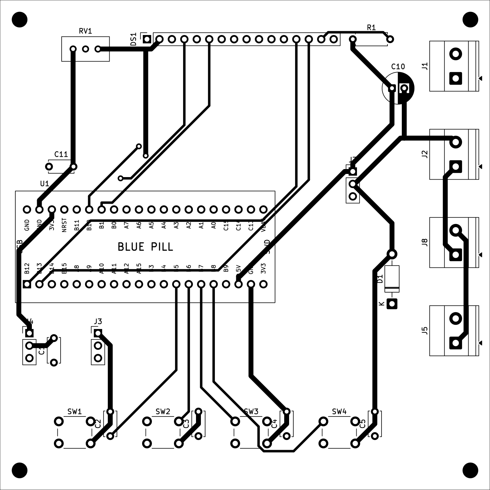

# Smart Irrigation System – Bài tập lớn LTHTN (HK261)

Thiết bị đo độ ẩm đất và tự động tưới cây, dùng **STM32F103C8 (Blue Pill)** + FreeRTOS.
Đồ án môn **Lập trình Hệ thống nhúng** – HCMUT.

Nhóm: Dũng · Ca · Thắng



## Chức năng

- Đọc độ ẩm đất qua ADC mỗi 1000 ms, quy đổi 0–100 % (độ phân giải 1 %).
- **AUTO**: bật bơm khi độ ẩm < ngưỡng (setpoint), tắt khi đạt ngưỡng.
- **MANUAL**: bật/tắt bơm bằng nút PUMP, không phụ thuộc cảm biến.
- LCD 16x2 hiển thị độ ẩm, ngưỡng, chế độ, trạng thái bơm.
- Gửi dữ liệu lên PC qua UART, ví dụ: `SOIL: 45% | SET: 60% | MODE: AUTO | PUMP: ON`.

## Cấu trúc repo

```
docs/                Đề tài, yêu cầu chung, bảng phân công, sơ đồ khối
hardware/kicad/      Project KiCad: schematic, PCB 10x10 cm, thư viện symbol/footprint riêng
hardware/images/     Ảnh xem nhanh schematic và PCB
firmware/            Code STM32 + FreeRTOS: app/ (task, logic), middleware/ (soil_sensor, lcd16x02, relay_pump)
docs/test/           Kịch bản kiểm thử
docs/flowcharts/     Lưu đồ giải thuật (mermaid + png)
simulation/mokxi/    diagram.json (định dạng Wokwi) + sketch.ino để mô phỏng trên Mokxi/Wokwi
```

## Gán chân (Blue Pill)

| Khối | Chân | Ghi chú |
|---|---|---|
| Cảm biến độ ẩm | PA0 (ADC1_IN0) | Cấp 3V3, tụ lọc 100 nF |
| UART → PC | PA2 TX, PA3 RX (USART2) | 115200 8N1, nối chéo TX/RX với USB-UART |
| Relay | PA4 | Module relay 5V, kích mức **thấp** |
| LCD 16x2 (4-bit) | RS PB0, E PB1, D4–D7 PB10–PB13 | RW nối GND, biến trở 10k chỉnh tương phản, 220 Ω đèn nền |
| Nút MODE / UP / DOWN / PUMP | PB5 / PB6 / PB7 / PB8 | Pull-up nội, nhấn = LOW, tụ 100 nF chống dội |
| Nạp / debug | Header SWD trên Blue Pill | PA13/PA14 không có trên 2 hàng chân bên hông |

## Phần cứng (KiCad)

Mở `hardware/kicad/smart_irrigation.kicad_pro` bằng KiCad 9/10. Thư viện symbol và footprint
riêng đã khai báo trong `sym-lib-table` / `fp-lib-table` của project (đường dẫn `${KIPRJMOD}`).

- Board 100 × 100 mm, 2 lớp, mặt dưới phủ đồng GND, 4 lỗ M3.
- Blue Pill cắm qua 2 hàng **header cái 1x20** (hàng cách nhau 15.24 mm), không hàn trực tiếp.
- LCD cắm qua header cái 16 chân; relay module gắn ngoài (J7 điều khiển, J8 tiếp điểm COM/NO).
- Dây tín hiệu 0.5 mm, dây nguồn 1.0 mm, khoảng cách 0.3 mm.
- ERC: 0 lỗi. DRC: 0 lỗi, còn 4 cảnh báo silkscreen của footprint nút nhấn chuẩn KiCad.

**Cần kiểm tra trước khi đặt mạch:** in PCB tỉ lệ 1:1 để ướm Blue Pill thật (pinout, khoảng
cách hàng, chiều USB) và hướng lỗ luồn dây của cầu đấu vít.

## Mô phỏng

Ubuntu không chạy được Proteus, nhóm dùng **Mokxi** (mô phỏng trên trình duyệt):

- `simulation/mokxi/mokxi_project.json`: project định dạng Mokxi (`mokxi-ai/1`), đã qua
  `validate_project` của Mokxi, 0 lỗi. Dùng cảm biến độ ẩm điện dung, máy bơm mini chạy pin 4xAA
  qua relay kích mức thấp, diode chống dòng ngược. Serial Monitor in gói tin UART.
- **Project Mokxi (layout gọn, chạy được):** https://app.mokxi.com/p/RN2hMLpKIqXbyVL_  
  Vị trí/đường dây nằm trong `diagram_mokxi_native.json`; code Mokxi: `sketch_mokxi.ino`.
- `simulation/mokxi/diagram.json` + `sketch.ino`: bản định dạng Wokwi (biến trở thay cảm biến,
  LED thay máy bơm).

Hằng số `ADC_DRY` / `ADC_WET` trong code phải hiệu chuẩn lại trên mạch thật.

## Việc tiếp theo

- [ ] Firmware STM32CubeIDE + FreeRTOS (5 task: SensorRead, ButtonProcess, Control, Display, UART_Tx)
- [ ] Xuất Gerber, làm mạch, hàn linh kiện
- [ ] Hiệu chuẩn cảm biến, chạy kịch bản kiểm thử
- [ ] Báo cáo
